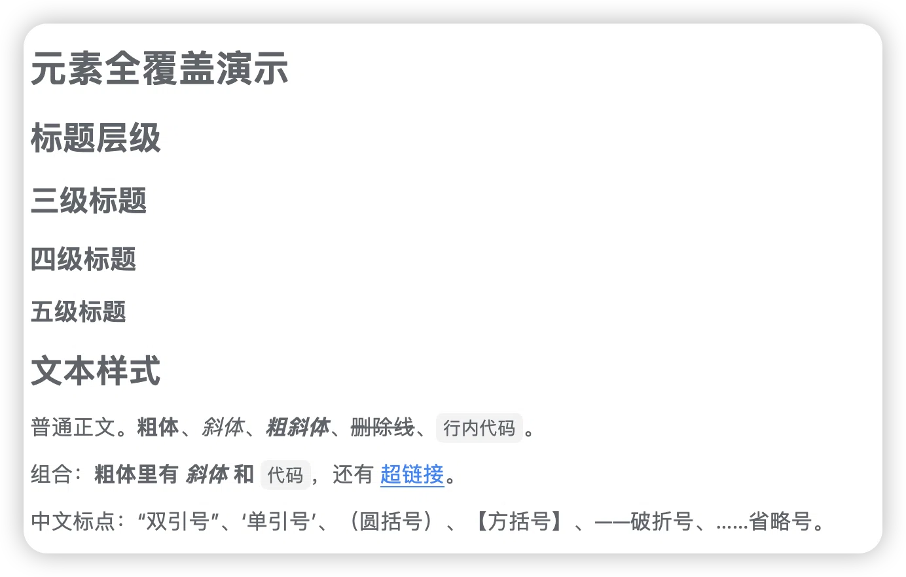
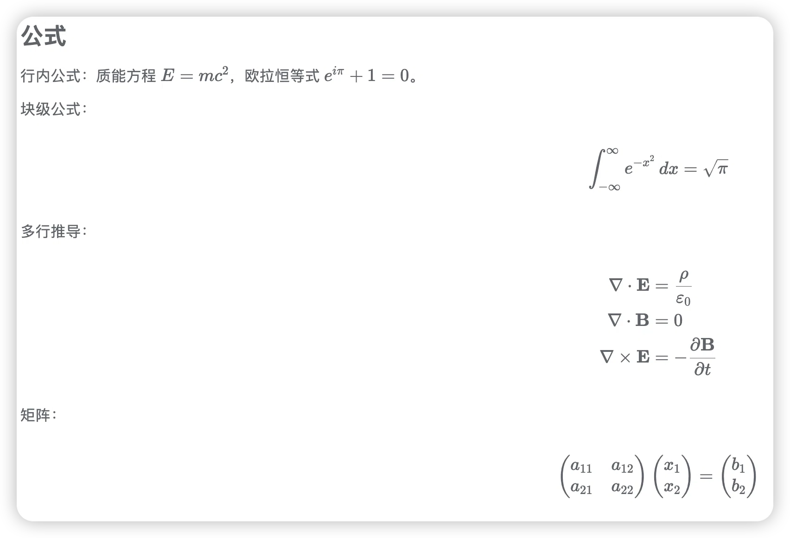
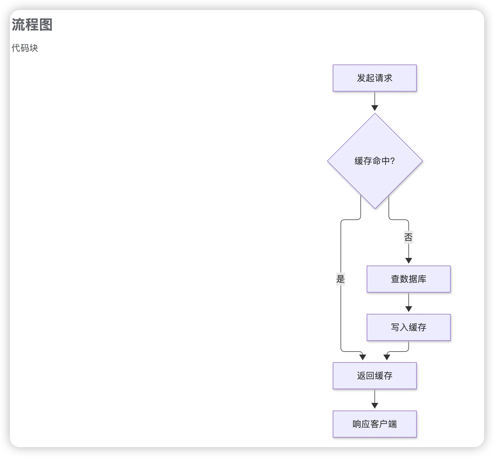
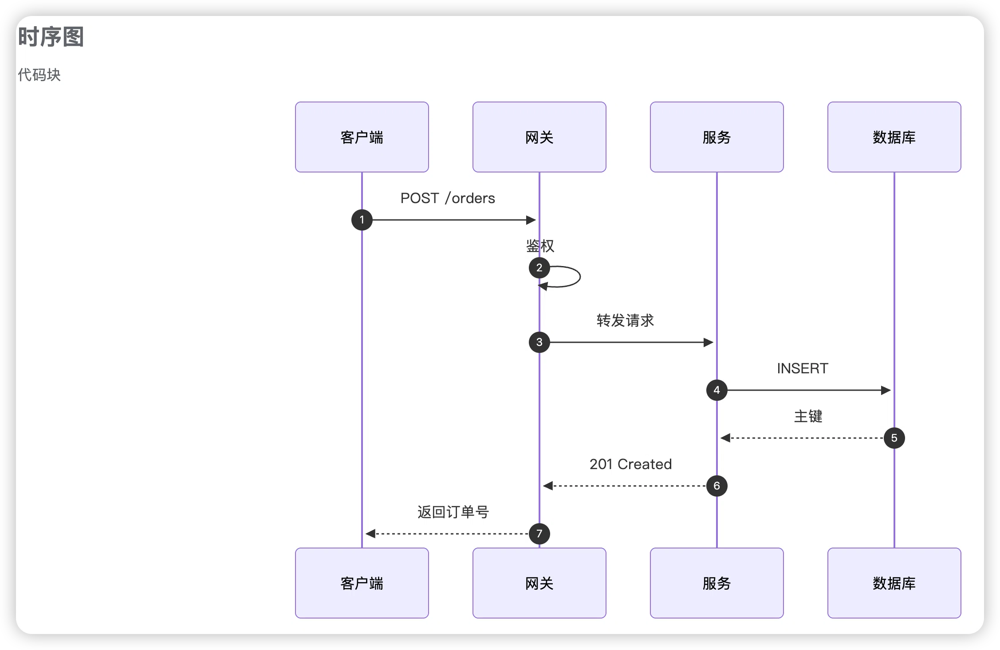
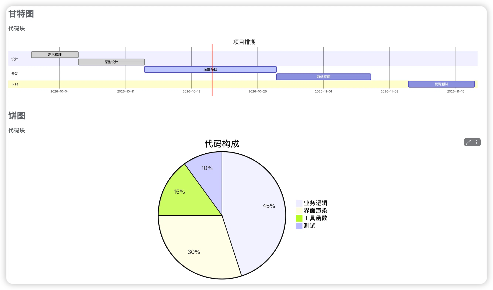
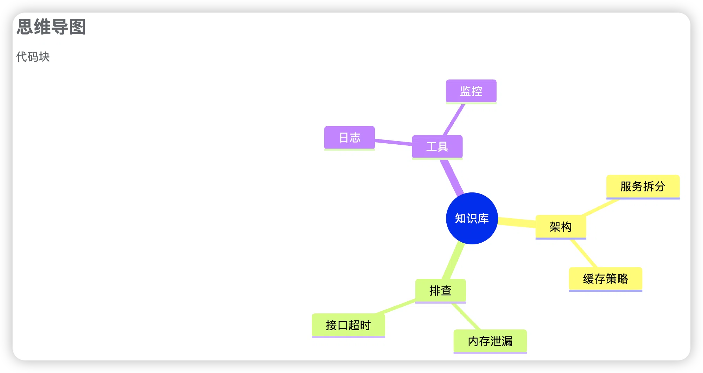
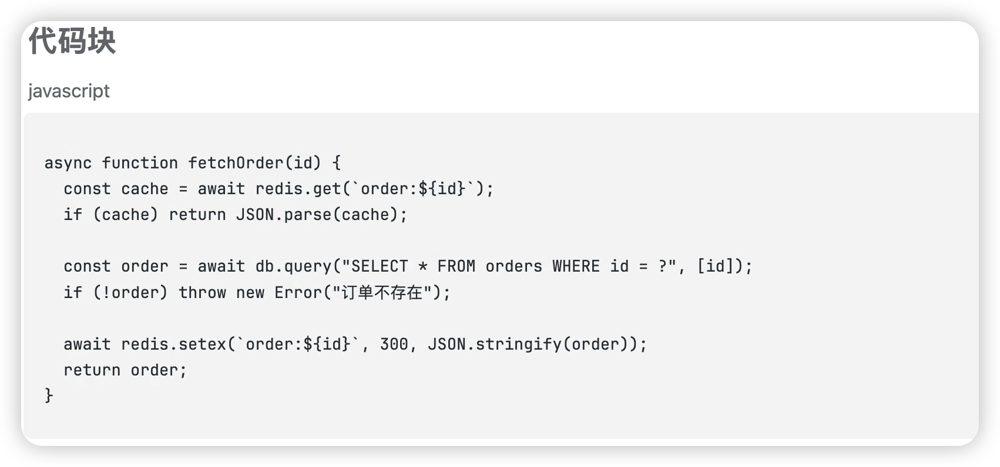
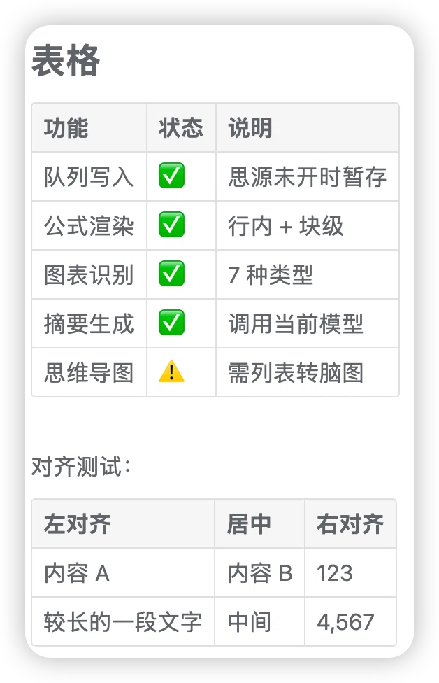
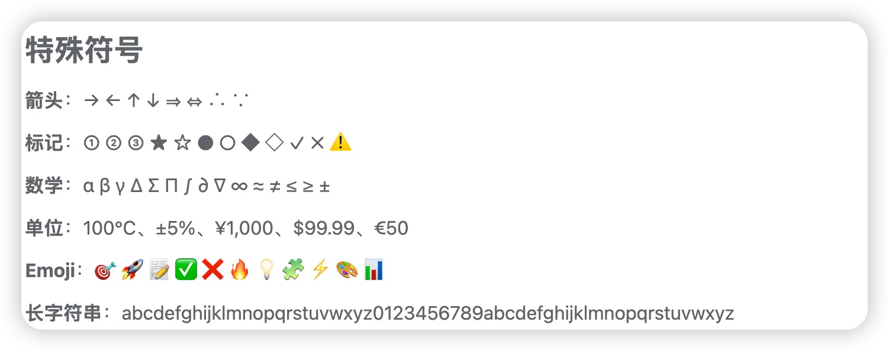

# dsh-siyuan

**把 DeepSeek Harness 里值得留下的对话，挑出来沉淀成你自己的开发知识库。** 右键选中，笔记就进了思源——公式和 mermaid 图表原样保留。

[中文](#中文) · [English](#english)

---

## 中文

### 为什么需要它

一次开发对话几千字，真正值得留下的可能就那么几段：一个想通的方案、一个踩了半天的坑、一组调出来的参数。剩下的推演和试错，过一周你也不会重读。

问题是这些碎片都埋在里面。整段存下来懒得翻，什么都不存下次重新踩一遍。

这个插件解决**挑选**：

- 你决定存什么——完整一轮，或只是某条讲清楚了问题的消息
- 存进来的部分能直接用——代码、公式、图表保持原样
- 慢慢长成知识库——几个月后搜一下「上次那个内存泄漏怎么定的」就有

思源在这里不是备份盘，是**组织层**：双链、大纲、标签、数据库视图都是现成的。

### 功能

- **三种同步粒度** —— 单条消息 / 本轮对话 / 整个窗口。助手消息的动作条上有「存」图标，Shift+点存整窗口
- **思源没开也不丢** —— 先进本地队列，每 30 秒探一次，思源启动后自动补写
- **写入前可改** —— 弹预览面板，标题和正文都能编辑
- **公式和图表** —— 行内公式、块级公式渲染成思源原生公式块；流程图、时序图、状态图、甘特图、饼图、类图都识别成图表
- **对话气泡** —— 用户蓝色、助手绿色，一眼分清谁说的
- **自动标签** —— 按内容打 `#方案设计#`、`#问题排查#` 这类标签，方便聚合检索
- **回链** —— 每段末尾标明来源的会话、轮次和时间
- **重复检测** —— 同样的内容再同步会提示已存过
- **AI 摘要** —— 整窗口同步时可调用当前模型生成结构化摘要，再连同全文一起存入
- **失败重试** —— 自动退避重试，面板里能看到失败原因

### 效果预览

下面全部是**从 DeepSeek Harness 对话框右键同步过去之后**，在思源笔记里的原始截图——没有手动排版，没有二次编辑。

对话里写什么，笔记里就是什么：Markdown 语法、LaTeX 公式、mermaid 图表、代码块、表格，全部按思源的块模型重新组织，而不是变成一堆纯文本。

<span>兼容性一览：</span>

| Harness 里的写法 | 同步后成为 | 是否丢格式 |
| :--- | :--- | :---: |
| `**粗体**` `*斜体*` `~~删除线~~` | 思源对应的行内样式 | ✅ 完整保留 |
| `$E=mc^2$` | 思源行内公式 `NodeMathInline` | ✅ 可编辑 |
| `$$...$$` | 思源公式块 `NodeMathBlock` | ✅ 可编辑 |
| ```mermaid flowchart | 思源图表块（可缩放） | ✅ 可交互 |
| ```javascript | 思源代码块 + 语法高亮 | ✅ 语言标记都保留 |
| Markdown 表格 | 思源表格块 | ✅ 对齐方式保留 |
| `- [x] 任务` | 思源任务列表块 | ✅ 可勾选 |
| 无序/有序列表 | 思源列表块（含嵌套） | ✅ 层级保留 |

**文本样式与标题** —— 对话里怎么写，笔记里就怎么显示。粗体、斜体、删除线、行内代码、超链接、中文标点全部原样保留，不是转成纯文本后重新加粗的

<div align="center">
  
  <br>
  <sub>标题层级与文本样式</sub>
</div>

**公式** —— 对话里写的 LaTeX 直接变成思源公式块，点一下就能继续编辑。行内、块级、多行对齐、矩阵都支持

<div align="center">
  
  <br>
  <sub>公式渲染</sub>
</div>

**流程图** —— 对话里是 ```mermaid 代码块，同步后思源自动识别并渲染成图形，不是一段代码

<div align="center">
  
  <br>
  <sub>流程图</sub>
</div>

**时序图** —— 多方交互和请求响应顺序，同步后保留全部结构

<div align="center">
  
  <br>
  <sub>时序图</sub>
</div>

**甘特图与饼图** —— 同一个对话里两种图都能识别，各按各的类型渲染

<div align="center">
  
  <br>
  <sub>甘特图与饼图</sub>
</div>

**思维导图** —— 对话里写的 mindmap 层级结构，同步后自动展开成树

<div align="center">
  
  <br>
  <sub>思维导图</sub>
</div>

**代码块** —— 语言标记（图里左上角的 `javascript`）都是同步时自动带过去的，缩进、注释、中文注释全部保留

<div align="center">
  
  <br>
  <sub>代码块高亮</sub>
</div>

**表格** —— Markdown 表格转成思源表格块，左中右对齐都能保留

<div align="center">
  
  <br>
  <sub>表格与对齐</sub>
</div>

**特殊符号** —— 箭头、数学符号、单位、Emoji、长字符串，同步过程不做任何转义或替换

<div align="center">
  
  <br>
  <sub>特殊符号与 Emoji</sub>
</div>

### 怎么用

右键任意消息：

| 菜单项 | 同步范围 |
|---|---|
| 同步这条消息到思源 | 只存这一条 |
| 同步本轮对话 | 这一轮问答 |
| 同步整个窗口的全部对话 | 窗口里所有已加载的对话 |
| 思源笔记设置… | 打开控制面板 |

### 用成知识库的几个习惯

1. **按主题建笔记本** —— 别堆在默认的 `deepseek对话` 里，改成 `架构决策`、`问题排查`、`性能优化`
2. **按价值选粒度** —— 一句话结论存单条，讲清一个问题存本轮，长推演存整窗口 + 摘要
3. **摘要当索引** —— 整窗口生成的摘要把结论和关键参数摘在前面，日常看摘要就够
4. **标签和双链串联** —— 把「当时定的方案」和「后来踩的坑」连起来
5. **定期整理** —— 散的合并成整篇，过时的删掉

### 安装

```sh
git clone https://github.com/LuoX218/dsh-siyuan.git
cd dsh-siyuan
./install.sh
```

重启 Harness，在 **设置 → 插件 → 第三方插件** 里能看到 `dsh-siyuan`。

**思源必须开着**——插件通过思源内核 API 写入，token 从 `conf/conf.json` 自动读取。

### 设置面板

入口：**设置 → 插件 → 第三方插件 → dsh-siyuan**，点「配置」。

面板顶部显示连接状态（思源是否可达、版本号），下面是四组设置。

#### 存放规则

决定内容写到哪、怎么组织。

| 设置项 | 选项 | 说明 |
| --- | --- | --- |
| **目标笔记本** | 任意名字 | 填不存在的名字会自动创建。想按主题分类就填 `架构决策`、`问题排查` |
| **日期格式** | `2026-10-20` / `2026/10/20` / `2026年10月20日` | 只影响文档标题和存放路径 |
| **归类方式** | 同一天追加一篇 / 每次新建文档 | 前者适合日记式归档，后者适合每次同步都是独立主题 |
| **每段时间标题** | 不添加 / 二级 / 三级 / 四级 | 每段内容开头那个时间戳的标题级别。三级适中，不添加则不显示时间 |

面板里会实时显示「存放位置：xxx / xxx」，改完立刻能看到最终路径。

#### 排版

控制同步过去的 Markdown 长什么样。

| 设置项 | 选项 | 说明 |
| --- | --- | --- |
| **段落之间的分隔线** | 显示（推荐）/ 不显示 | 每次同步之间插一条 `---`，多次同步视觉上分得开 |
| **每段显示时间戳** | 显示 / 不显示 | 关掉后只保留正文，适合连续记录同一主题 |
| **流程图 / 图表配色** | 跟随思源 / 强制浅色 / 强制深色 / 高对比 | mermaid 的配色方案。夜间看不清时改「强制深色」或「高对比」 |
| **自动标签** | 按内容自动加标签 / 不加标签 | 命中关键词时在正文前插 `#方案设计#` 这类标签 |

#### 摘要

只在同步整个窗口时生效。

| 设置项 | 选项 / 说明 |
| --- | --- |
| **整窗口同步时** | 「先问是否提取摘要」会弹选择框；「直接存全文」跳过提问 |
| **提取摘要的提示词** | 多行文本框，可完全自定义。**留空则用内置模板**（概览 / 时间线 / 主要工作 / 关键信息 / 问题与解决 / 图文 / 后续，并要求配 gantt、flowchart、pie 等图表） |

提示词失焦自动保存。想强制某种输出格式，直接在里面写就行，比如「每次都要有饼图」。

#### 行为

| 设置项 | 选项 | 说明 |
| --- | --- | --- |
| **写入前预览** | 先预览再写入 / 直接写入 | 预览面板里可以改标题和正文，确认后才写。觉得多余就关掉 |
| **重复内容提醒** | 已存过时提示我 / 不检查直接存 | 按内容指纹判断，避免同一段内容反复堆积 |

#### 队列管理

面板下半部分是待写入队列，每条显示标题、字数、相对时间、重试次数和失败原因。

- **重试** —— 单独补写这一条
- **删除** —— 不要了
- **立即写入 N 条** —— 队列整体补写
- **重新检测** —— 重新探测思源地址

失败原因分四类：`offline`（思源没开）、`auth`（token 失效）、`missing`（目标文档被删，会自动重建）、`other`（其他错误，附原始信息）。

### 已知限制

| 限制 | 原因 |
|---|---|
| 思源必须运行才能写入 | 写入只能走内核 API |
| 思维导图不能直接生成 | 思源的脑图是原生块，需从列表右键转换 |
| 已有内容不会自动更新 | 改了排版设置只影响新同步的内容 |
| 摘要需要先选模型 | 会话没选模型时无法生成 |

### License

MIT

---

## English

**Pick out what's worth keeping from DeepSeek Harness and grow it into your own development knowledge base.** Right-click to save into SiYuan; formulas and mermaid diagrams come through intact.

### Why

A development conversation runs thousands of words. What's actually worth keeping might be a few paragraphs: a design that clicked, a bug that ate an afternoon, a set of tuned parameters. The rest you won't reread.

This plugin is about **selection** — you decide what's kept, what's kept stays usable, and it compounds into a searchable knowledge base.

SiYuan isn't a backup drive here; it's the organization layer: backlinks, outlining, tags, database views.

### Features

- **Three sync scopes** — single message / current turn / whole window. Assistant rows carry a save icon; Shift+click saves the whole window
- **Nothing lost when SiYuan is down** — local queue, probed every 30s, flushed automatically
- **Editable preview** — tweak the title and body before writing
- **Formulas and diagrams** — inline and block math become native SiYuan math blocks; flowchart, sequence, state, gantt, pie, and class diagrams render as diagrams
- **Speaker bubbles** — user in blue, assistant in green
- **Auto tags** — `#design#`, `#troubleshooting#` and friends, for aggregation
- **Backlinks** — each segment notes its session, turn, and timestamp
- **Duplicate detection** — the same content prompts before being saved twice
- **AI summary** — for whole-window syncs, call your current model for a structured summary alongside the transcript
- **Retry with backoff** — failure reasons surface in the panel

### Screenshots

Every image below is a <strong>raw screenshot of SiYuan</strong> after right-clicking sync in a DeepSeek Harness conversation — no manual formatting, no re-editing.

What you type in the chat is what lands in the note: Markdown, LaTeX, mermaid, code fences, tables — all rebuilt as SiYuan's native blocks instead of flattened into plain text.

| Written in Harness | Becomes in SiYuan | Fidelity |
| :--- | :--- | :---: |
| `**bold**` `*italic*` `~~strike~~` | matching inline styles | ✅ |
| `$E=mc^2$` | inline math `NodeMathInline` | ✅ editable |
| `$$...$$` | math block `NodeMathBlock` | ✅ editable |
| ```mermaid flowchart | diagram block | ✅ interactive |
| ```javascript | code block with highlighting | ✅ language marker kept |
| Markdown table | table block | ✅ alignment kept |
| `- [x] task` | task list block | ✅ checkable |

<div align="center">
  
  <br>
  <sub>Inline and block formulas become native SiYuan math blocks</sub>
</div>

<div align="center">
  
  <br>
  <sub>Mermaid flowcharts render as interactive diagrams</sub>
</div>

<div align="center">
  
  <br>
  <sub>Gantt charts for schedules, pie charts for proportions</sub>
</div>

<div align="center">
  
  <br>
  <sub>Tables keep their alignment and status markers</sub>
</div>

See the <a href="#中文">Chinese section</a> for the full gallery.

### Usage

Right-click any message:

| Item | Scope |
|---|---|
| Sync this message | Just this one |
| Sync this turn | The question-and-answer pair |
| Sync the whole window | Everything loaded |
| SiYuan settings… | Open the panel |

### Install

```sh
git clone https://github.com/LuoX218/dsh-siyuan.git
cd dsh-siyuan
./install.sh
```

Restart Harness; the plugin appears under **Settings → Plugins → Third-party plugins**.

**SiYuan must be running** — writes go through its kernel API, with the token read from `conf/conf.json`.

### Settings

Open via **Settings → Plugins → Third-party plugins → dsh-siyuan → Configure**. The panel header shows connection status; four groups follow.

**Storage** — target notebook (created on demand), date format, grouping mode (one note per day vs. one per sync), timestamp heading level.

**Layout** — separator between segments, timestamp visibility, mermaid color scheme (follow theme / force light / force dark / high contrast), auto-tagging on or off.

**Summary** — whether whole-window syncs ask before summarizing, and a fully customizable summary prompt (leave empty for the built-in archival template).

**Behavior** — preview before writing, duplicate detection.

The queue section at the bottom lists pending entries with retry counts and failure reasons, each individually retryable or removable.

### Known limitations

| Limitation | Reason |
|---|---|
| SiYuan must be running | Kernel API is the only write path |
| No direct mindmap generation | SiYuan mindmaps are native blocks; convert from a list |
| Existing content isn't updated | Layout changes only affect new syncs |
| Summary needs a selected model | Uses the current session's model |

### License

MIT